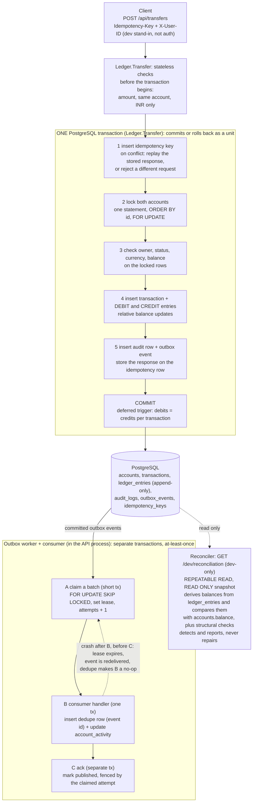

# LedgerFlow architecture

One Go binary, one PostgreSQL database. PostgreSQL is the single source of truth; the Go code is a thin layer that issues explicit SQL inside transactions.

## Overview

- **Atomic part:** only box 1 is one transaction. The outbox row commits with the money movement, so "money moved" and "event recorded" cannot diverge.
- **Delivery is not atomic with the transfer:** the worker claim, the consumer's effect and the `published` mark are separate transactions. A crash between B and C causes redelivery, which is why delivery is **at-least-once, not exactly-once**, and why the consumer deduplicates.
- **Reconciliation is outside the transfer path.** It never writes. It checks stored state against the ledger; it does not check `account_activity`, which legitimately lags.

The diagram follows the code: `Ledger.Transfer` and `post()` in `internal/ledger`, `Worker`/`Consumer` in `internal/outbox`, and `reconcile.Run` in `internal/reconcile`. The sections below give the detail.

## What is enforced where

| Property | Enforced by | Evidence | Limits |
|---|---|---|---|
| Ledger entries are append-only | **Database:** triggers reject `UPDATE`, `DELETE`, `TRUNCATE` | automated test | Table owners/superusers can disable triggers. `transactions` and `accounts` rows are **not** immutable |
| Each transaction's debits equal its credits | **Database:** deferred constraint trigger at commit | automated test (unbalanced commit rejected) | Sums amounts only and ignores currency, so 10 INR debited against 10 USD credited passes. A transaction with zero entries never fires it. It does not tie entries to the transaction's accounts or amount |
| User balances never go negative | **Database:** `CHECK` | automated tests | The seeded system funding account may go negative |
| A transfer is atomic (ledger, balances, audit, outbox, idempotency record) | **Application:** one PostgreSQL transaction | failure-injection test that rolls back after a late failure | Nothing in the database ties `accounts.balance` to ledger entries |
| No overspend or deadlock under concurrency | **Application:** ordered `FOR UPDATE` locks, balance checked after the lock | concurrency tests assert exact balances and entry counts; removing the lock was manually verified to fail them | Not tested under process kill or database restart |
| Idempotent retries, including concurrent duplicates | **Application:** key inserted first inside the transaction, unique index | automated tests | Keys never expire; a rejected request keeps no key |
| Events delivered at-least-once; consumer effect applied once | **Application:** leases and attempt fencing; dedupe row committed with the effect | automated tests with simulated crashes and lost acks | Not exactly-once; no ordering guarantee; crashes are simulated, not real process kills |
| Stored state agrees with the ledger | **Reconciliation,** after the fact | tests that inject corruption in never-committed transactions | Detects only: it does not prevent corruption, repair anything, or prove each transaction was originally correct. It assumes the current two-leg model |

**Known gaps in the database guarantees** (these are what reconciliation exists to surface):
- A `transactions` row with zero ledger entries can commit.
- The balance check is currency-blind: balanced entries in mixed currencies can commit.
- Entries are not tied to their transaction's source, destination, amount or currency.
- `transactions` and `accounts` are mutable, and `accounts.balance` is only a cache the code keeps in step.
- Database owners and superusers can disable the triggers.

Reconciliation can show that stored balances and the structural checks agree with the ledger as it now stands. It cannot prove that every transaction was originally correct (a wrong amount posted consistently looks valid), and it does not prevent or repair anything.

## Double-entry ledger

Every money movement is a `transactions` row plus two `ledger_entries` rows: a `DEBIT` on the source and a `CREDIT` on the destination for the same positive amount (`entry_type` is the direction). The invariant `SUM(debits) = SUM(credits)` is enforced by the database: a deferred constraint trigger checks each transaction's entries at commit. Entries are append-only: triggers reject `UPDATE`, `DELETE` and `TRUNCATE`. Corrections would be new, offsetting transactions.

Convention: CREDIT increases an account's balance, DEBIT decreases it. Opening balances in dev come from a seeded `system` account (the only kind allowed to go negative), so even deposits are balanced double entries.

## Materialized balance

`accounts.balance` is a cached value for cheap reads; the ledger is authoritative (balance = credits − debits). It is only changed in the same transaction that inserts the entries, using relative updates (`balance = balance - $1`). A `CHECK (balance >= 0)` on user accounts is a last-line backstop. Tests compare stored and ledger-derived balances for the accounts each scenario touches, and reconciliation (below) does the same for every account. Removing the row lock was manually verified to make the concurrency tests fail; that is a one-off manual check, not an automated test.

## Transaction boundary

`Ledger.Transfer` opens one `pgx` transaction and everything happens inside it:

1. claim the idempotency key (or replay)
2. lock both account rows
3. validate ownership, status, currency, balance
4. insert transaction, debit entry, credit entry
5. update both balances
6. insert audit log and outbox event
7. store the response on the idempotency row
8. `COMMIT`

Any error returns early and a deferred `Rollback` discards all of it. Nothing external (HTTP calls, notifications) happens inside the transaction.

## Concurrency

`SELECT ... FROM accounts WHERE id = ANY($1) ORDER BY id FOR UPDATE` locks both rows. A concurrent transfer touching either account waits at that statement; under `READ COMMITTED` the balance it reads after the lock is the latest committed value, so the balance check and the update cannot interleave with another writer (no lost updates, no overdraft races). Locking in `id` order means opposing transfers (A→B and B→A) cannot deadlock. Chosen over `SERIALIZABLE` because it is simpler to reason about and needs no retry loop.

## Idempotency

Scope is `(user_id, Idempotency-Key)`, the primary key of `idempotency_keys`. The row stores a SHA-256 of the material request fields (operation, source, destination, amount, currency).

The key is inserted **first, inside the financial transaction**, with `ON CONFLICT DO NOTHING`:

- Inserted → this request owns the key and proceeds; at the end it stores the response JSON on the same row, and the row commits atomically with the money movement.
- Not inserted, because a committed row exists → compare hashes: same → return the stored response (replay); different → `idempotency_key_reuse`.
- A concurrent duplicate whose twin is still in flight **blocks on the unique index** until the twin commits (then it replays) or rolls back (then it runs for real). Two identical concurrent requests therefore cannot both execute.

Because the key and the transfer commit or roll back together, there is no "key saved but transfer not done" state, and no in-progress/crash-recovery states to manage. Trade-off: rejected requests (e.g. insufficient funds) are rolled back with their key, so a client may retry the same key and get a fresh evaluation.

## Transactional outbox

`outbox_events` is written in the transfer transaction, so "money moved" and "event recorded" commit atomically; a crash can't produce one without the other. A worker (`internal/outbox`) then delivers events **at-least-once**.

### States

| status | meaning |
|---|---|
| `pending` | not yet delivered. Claimable when `next_attempt_at <= now()` and it has no live lease |
| `published` | handler succeeded and the lease holder acknowledged (`published_at` set) |
| `failed` | gave up after `MaxAttempts`; kept for inspection, never claimed again unless deliberately retried |

Transitions:

- `pending` → claimed: `locked_by`/`locked_until` set, `attempts + 1` (a crash still costs an attempt)
- claimed → `published`: ack
- claimed → `pending`: handler error with attempts left; lease cleared, `next_attempt_at = now() + min(max, base * 2^(attempt-1))`, `last_error` recorded
- claimed → `pending`: graceful shutdown "release"; lease cleared and the attempt is not counted
- claimed → `failed`: handler error at `attempts >= MaxAttempts`, or the lease expired while `attempts >= MaxAttempts` (crash on the final attempt)
- `failed` → `pending`: `RetryFailed` (dev endpoint `POST /dev/outbox/{id}/retry`); `attempts` reset, `last_error` kept as history
- claimed, lease expired → claimable again by any worker (crash recovery)

### Claiming and fencing

A claim is a short transaction: `UPDATE … FROM (SELECT … WHERE eligible ORDER BY next_attempt_at, id LIMIT n FOR UPDATE SKIP LOCKED)`, then commit. Row locks are released before the handler runs, and concurrent workers get disjoint events. Eligibility uses `next_attempt_at` and the lease, never an id cursor: identity ids are assigned at insert, not commit, so `id > last_seen` can skip late-committing rows. All time comparisons use database `now()`, so worker clock skew doesn't matter.

Ack, fail and release only apply `WHERE locked_by = me AND attempts = <claimed attempt>`. `attempts` increases on every claim, so it acts as a fencing token: a stale worker whose lease expired and was reclaimed (even by a worker with the same id) gets `ErrLeaseLost` and cannot change the newer claim. Handlers run with a timeout equal to the lease.

### Delivery semantics and the idempotent consumer

The consumer's effect and the worker's `published` mark are **separate transactions** on the same database; application code cannot make them one. If the process dies after the consumer commits but before the ack, the lease expires and the event is delivered again. Therefore delivery is at-least-once, **not** exactly-once, and handlers must tolerate duplicates.

The demo consumer (`account_activity` read model) does this by inserting `(consumer, event_id)` into `consumer_processed_events` and applying its effect **in one transaction**. A redelivery hits the primary key (`ON CONFLICT DO NOTHING`) and does nothing; a failure after the dedupe insert rolls both back so the retry isn't skipped. Accounts are updated in id order so concurrent consumers can't deadlock.

Ordering is not guaranteed: workers run concurrently and failed events retry later.

## Reconciliation (core engine)

`internal/reconcile` re-derives what the ledger implies and compares it with what is stored. It **detects and reports; it never repairs.** `reconcile.Run(ctx, pool, opts)` returns a `Report`. It is exposed only as the development endpoint `GET /dev/reconciliation` (see below); there is no scheduler or persisted run yet.

- **Isolation:** one `REPEATABLE READ, READ ONLY` transaction for the whole report, with a transaction-local `statement_timeout` (default 30s, applied **per statement**, not to the whole report). Every query sees one snapshot, so transfers committing mid-report cannot cause false mismatches (`READ COMMITTED` would take a new snapshot per statement). It takes no row locks and cannot write. `Check(ctx, tx, opts)` is the same logic on a caller-supplied transaction (tests use it to inspect uncommitted corruption) and refuses a `READ COMMITTED` transaction.
- **Independent derivation:** expected balance = `SUM(CREDIT) - SUM(DEBIT)` over `ledger_entries`, computed in SQL with `NUMERIC` (no BIGINT overflow; sums are reported as decimal strings). Accounts are `LEFT JOIN`ed to the sums, so accounts with no entries and the system funding account are always compared. None of the transfer writer's code is reused.
- **Findings are data, not errors.** The report has a `Consistent` flag, snapshot metadata (database clock, `pg_current_snapshot()`, highest visible entry id, and the isolation/read-only/timeout settings PostgreSQL reports; informational only, **not** a safe cursor for incremental runs because identity ids are assigned at insert, not commit), accounts/transactions/entries checked, exact per-category counts, per-currency credit/debit totals, and a deterministic list of discrepancies capped at 100 (`Truncated` says if more exist).

| Category | Detects |
|---|---|
| `BALANCE_MISMATCH` | stored `accounts.balance` ≠ ledger-derived balance |
| `TXN_NO_ENTRIES` | a transaction with no ledger entries (the balanced-entries trigger never sees this) |
| `TXN_UNBALANCED` | a transaction's debit total ≠ credit total |
| `TXN_SHAPE_MISMATCH` | not exactly one DEBIT on the source and one CREDIT on the destination, each with the transaction's amount and currency |
| `ENTRY_CURRENCY_MISMATCH` | an entry's currency ≠ its account's currency |
| `CURRENCY_NOT_CONSERVED` | within one entry currency, total credits ≠ total debits (the database's balance check is currency-blind) |
| `MISSING_AUDIT_OR_OUTBOX` | a completed transaction lacking its `audit_logs` or `outbox_events` row |

### `GET /dev/reconciliation`

Registered only when `DEV_ENDPOINTS=true` (otherwise the route does not exist: 404). It is never under `/api`. It is **unauthenticated and does not read `X-User-ID`**, and it lists every account, so it is a development tool, not a user-facing feature; enabling `DEV_ENDPOINTS` does not make the application production-safe. It runs `reconcile.Run` on the shared pool with default options (limit 100, 30s statement timeout) and returns the `Report` as JSON.

- A completed report with discrepancies is **200** with `"consistent": false` and the findings in the body; discrepancies are never errors.
- Failing to produce a report is an error with the usual `{"error":{"code","message"}}` envelope and no database detail (details go to the server log): **503** `reconciliation_timeout` if PostgreSQL cancelled a statement for exceeding `statement_timeout`, otherwise **500** `internal_error`.
- Only `GET` is routed (other methods: 405). There are no query parameters yet, so the cap and timeout are not adjustable over HTTP.
- `docker-compose.yml` sets `DEV_ENDPOINTS` to `true` unless overridden, so the default Compose stack exposes this unauthenticated all-account report along with the other `/dev` routes. Compose publishes the ports on `127.0.0.1` only and the API logs a startup warning when dev endpoints are enabled, but the routes are still unauthenticated. That default is for local development only.

Assumptions and limits:

- `TXN_SHAPE_MISMATCH` encodes the **two-leg model the current implementation writes**, not a universal accounting rule; multi-leg postings would require changing it. Zero-entry transactions are reported only as `TXN_NO_ENTRIES`.
- `MISSING_AUDIT_OR_OUTBOX` is separate from the balance checks (`Options.SkipAuditOutbox` disables it). It checks presence only (audit: `entity_type='transaction'`, `entity_id`, `success`, `action='<type>.completed'`; outbox: `aggregate_type='transaction'`, `aggregate_id`, `event_type='<type>.completed'`) and assumes those tables are never pruned. `account_activity` (an eventually consistent read model) is deliberately not compared.
- A clean report shows that stored state agrees with the ledger and the structural checks; it cannot show that a consistently posted wrong amount is correct.
- Cost is a full scan of `ledger_entries` per report. No index was added: there is no measurement on a large dataset yet.

## Audit logging

`audit_logs` records `user_id`, `action` (`transfer.completed`), the transaction as `entity`, `success`, JSON details (accounts, amount, currency) and a timestamp, written in the same transaction. Only successful operations are audited at present.

## Testing and test databases

Database-backed tests need `TEST_DATABASE_URL`. **If it is unset they call `t.Skip` and `go test` still reports `ok`**, so a passing run is verification only if `-v` shows `PASS` rather than `SKIP`.

Most ledger and HTTP tests share one database and isolate themselves by creating their own users and accounts (the ledger cannot be truncated). Tests that need exclusive state or a database-wide change use a database named `<TEST_DATABASE_URL database>_<suffix>`, created on demand by `testutil.IsolatedPool` (the DB user needs `CREATEDB`):

| suffix | used by |
|---|---|
| `_outbox`, `_outbox_migrate` | outbox worker and migration tests (the worker claims every pending row) |
| `_reconcile` | reconciliation engine tests (exact discrepancy counts) |
| `_reconcile_http` | reconciliation endpoint tests |
| `_e2e` | the end-to-end test that runs a real worker |
| `_ledger_rollback` | the rollback test, which installs a database-wide trigger |

Rules: inject corruption only inside transactions that are never committed (reconciliation tests do this), because committed corruption in `ledger_entries` is permanent; and never run a mutation experiment that breaks the real writer against a standing test database. The mutation checks mentioned in these docs were done manually and are not part of the test suite. There is no CI workflow, and resilience to process kills or database restarts has not been tested (crashes and lease expiry are simulated). [CLAUDE.md](../CLAUDE.md) has the detailed rules.
